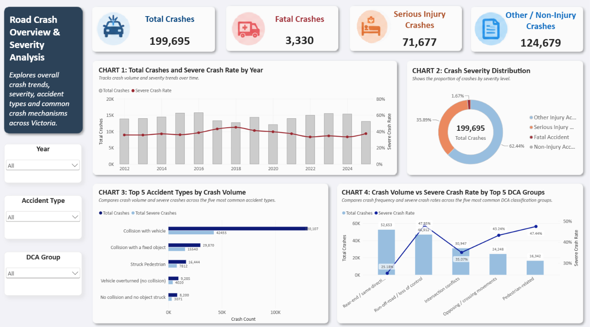
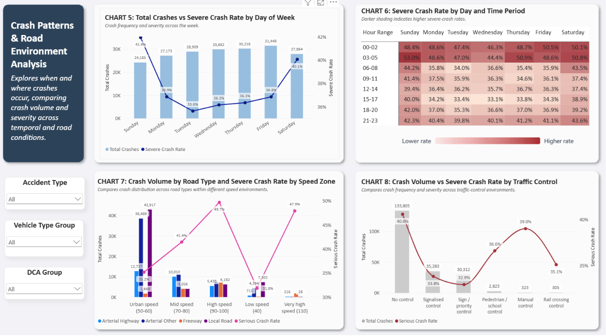
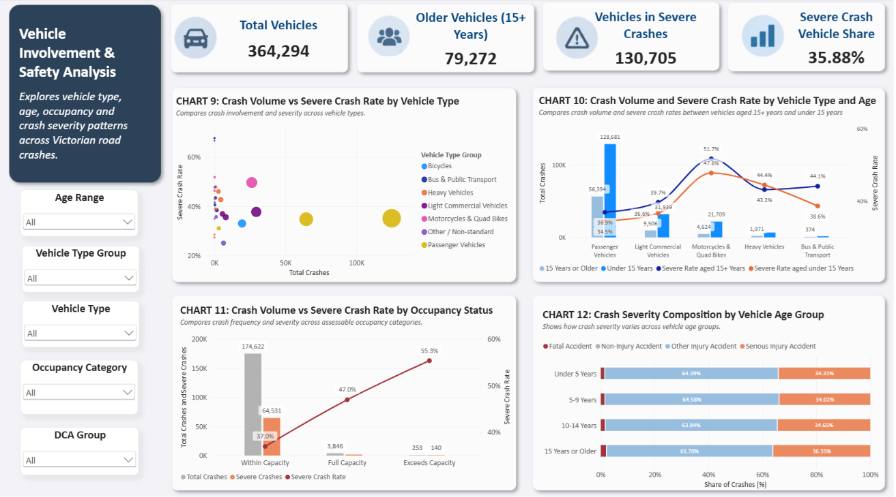

# Road Accident and Vehicle Analysis

## Project Overview

This project analyses road crash and vehicle data in Victoria, Australia, to explore accident patterns, crash severity, and vehicle characteristics.

The project includes data profiling and cleaning using Python, followed by interactive visualisation in Power BI.


## Data Sources

This project uses two road crash datasets from Victoria, Australia:

- **Accident:** Crash details, severity, casualties, dates, and road conditions.
- **Vehicle:** Vehicle types, characteristics, occupancy, and crash involvement.

The datasets are linked using `ACCIDENT_NO`.

The raw datasets are included in the [`data/raw/`](data/raw/) folder, and the cleaned datasets are available in [`data/processed/`](data/processed/).

## Tools & Technologies

- **Python:** pandas, NumPy, Matplotlib
- **Power BI:** Power Query, DAX, interactive dashboards
- **Jupyter Notebook:** Data profiling and cleaning

## Data Preparation

The data preparation process is documented in two notebooks:

- [`01_data_profiling.ipynb`](notebooks/01_data_profiling.ipynb): Examines missing values, duplicates, unusual values, and data consistency.
- [`02_data_cleaning.ipynb`](notebooks/02_data_cleaning.ipynb): Handles missing and invalid values, standardises categories, applies imputation, and validates the cleaned datasets.

Accidents with inconsistent vehicle counts are excluded from the cleaned datasets and saved separately as exception records.


## Power BI Dashboard

The interactive Power BI report contains three pages:

### 1. Road Crash Overview & Severity Analysis

Examines crash trends, severity distribution, accident types, and DCA groups.



### 2. Crash Patterns & Road Environment Analysis

Explores crash patterns by day, time, road type, speed zone, and traffic control.



### 3. Vehicle Involvement & Safety Analysis

Analyses vehicle types, vehicle age, occupancy status, and their relationships with crash severity.




## Project Structure

```text
road-accident-vehicle-analysis/
├── data/
│   ├── raw/
│   └── processed/
├── notebooks/
│   ├── 01_data_profiling.ipynb
│   └── 02_data_cleaning.ipynb
├── dashboard/
│   ├── road-crash-dashboard.pbix
│   └── screenshots/
├── README.md
├── requirements.txt
└── .gitignore
```


## How to Run

1. Clone the repository.
2. Install the required Python libraries:

   ```bash
   pip install -r requirements.txt
   ```

3. Run the notebooks in order:
   - `01_data_profiling.ipynb`
   - `02_data_cleaning.ipynb`
4. Open the Power BI report in the `dashboard/` folder.

The cleaning notebook exports the processed datasets to `data/processed/`.

## Limitations

Some missing values were imputed using median values, which may not represent actual vehicle characteristics. Records with inconsistent vehicle counts were excluded from the cleaned datasets but preserved separately for traceability.
